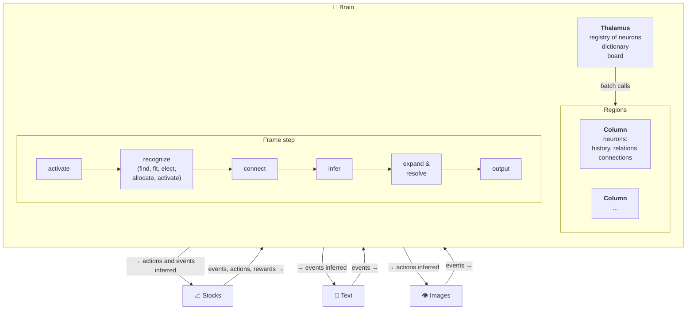

# Robot Brain

A machine that detects patterns in space and time and gives each pattern that keeps recurring a neuron of its own.
Those neurons are symbols too, so the patterns they form get neurons in turn, level by level, and what the machine
sees comes to be stated more and more briefly. Every neuron also remembers what followed it and what reward that
earned; each frame, the neurons that describe the present say what usually comes next and how well it paid, and the
machine acts on the best estimate.

No backpropagation, no gradients, no training epochs: it learns online, one frame at a time, from what it observes,
what ran and what it earned.

The algorithm is **Universal Compression with Actions and Rewards (UCAR)**, specified in
[docs/algorithm.md](docs/algorithm.md). The brain core is implemented in Rust (with Rayon multi-threading) and exposed
to Node.js via N-API.

## How It Works

**The world** reports, each frame, a value for each dimension that fires: events (what is observed) and actions (what
ran), grouped into channels, at positions in time and, for images, in space. Rewards arrive with a frame and are scoped
to the action channels and the span of frames they pay.

**Every symbol is a neuron.** Every activation of a neuron is a node of a graph, and every relation between two
activations, one at an offset from the other in time and space together, is an edge. The graph holds offsets, never
coordinates, so a pattern learned at one position is known everywhere.

**Compression names what recurs.** The machine groups edges that keep recurring into **functions**, graphs over
neurons, and names each with an **interneuron**. From then on the name stands where the graph recurs: a **call**, one
activation of the interneuron. Interneurons are nodes like any other, so the next level groups them in turn, and the
**dictionary** is a hierarchy of named graphs. A function is taken where it saves more than it costs; costs are counted
in edges.

**The apex is the situation.** What no call covers stands on the apex: the machine's state at a frame.

### The frame step

Each frame, the machine:

1. **Activates** the base neurons of what was observed and what ran; each refreshes its history and reports the
   relations it holds to its neighbors.
2. **Recognizes**, level by level: finds the functions the relations fit, elects the calls to keep, allocates
   interneurons for new functions, and activates the calls, which cover what they stand for.
3. **Connects**: each activation on the apex records what followed it, with the reward that earned, as connections.
4. **Infers**: each neuron on the apex infers from its connections what follows it, each with an estimate (the
   average reward per time seen).
5. **Expands** inferred calls down to the base neurons they stand for, and **resolves** one winner per dimension: in an
   action dimension the action with the largest estimate, in an event dimension the event the most inferences name.
6. **Outputs** the actions and events it infers for the frame ahead. The world executes the actions and reports what
   ran, what was observed and what it earned.

Interneurons whose last function has left the dictionary are decommissioned.

## Quick Start

**Prerequisites:** [Node.js](https://nodejs.org/) (with [pnpm](https://pnpm.io/)) and the [Rust toolchain](https://rustup.rs/) (the brain core is compiled from Rust into a native Node.js addon).

```bash
# Clone the repository
git clone https://github.com/cucar/robot_brain.git
cd robot_brain

# Install dependencies (pnpm workspace — links robot-brain into each app)
pnpm install
```

### Build the native addon

The demos load a compiled native addon (`brain/brain-napi/brain-napi.node`) built from the Rust core. Build it once before running any demo (and again after changing Rust code). The build script compiles `brain-napi` in release mode and copies the platform artifact into place.

**Linux / macOS:**

```bash
cd brain
./build.sh
```

**Windows (PowerShell):**

```powershell
cd brain
./build.ps1
```

## Demos

The brain is a general architecture; these demos apply it to different domains. Each lives in its own document with
runnable commands, expected output, and the benchmarks it holds.

- **[Stock & Time-Series Demos](docs/stock-demos.md)** — laps that repeat, trading on ~21 years of real daily
  history, and memorizing that history over several passes; with a random baseline to compare against.
- **[Text Demos](docs/text-demos.md)** — character-sequence prediction on a text file and short texts.
- **[MNIST Demos](docs/mnist-demos.md)** — handwritten digits: training, frozen evaluation, and class-incremental
  Split-MNIST.
- **[Shape Demos](docs/shape-demos.md)** — lines, squares, and a 2 and a 3 on a grid of pixels.
- **[Tap Demos](docs/tap-demos.md)** — tap while go, then done: an action taught with rewards.

Every demo runs on included data with no API key.

## Benchmarks

23 runs of the demos with fixed settings check that a change to the brain leaves its behavior the same. Each run's
output is saved in [docs/benchmarks/output](docs/benchmarks/output), and each demo document describes its benchmarks.

```bash
node apps/benchmarks/run.js [--only <name>] [--record] [--regions <R>] [--columns <C>] [--flag <flag>]... [--out <folder>] [--data <folder>]
```

The runner builds the Node addon, runs each benchmark's job (listed in `apps/benchmarks/list.js`), strips the timings
from what it printed, and compares its result lines with the saved stdout: `same` or `different` per benchmark, with
its run time; it exits non-zero where any differs. `--record` saves each run's output as the expected one; `--flag`
passes a flag to every job. The MNIST benchmarks read the data from `apps/mnist/data`, downloading it there if it is
missing. Every benchmark gives the same output on every run: nothing in the brain reads the clock or a random number
into a result.

## Architecture



Every access to a neuron is a batch call the thalamus fans out over the columns, in parallel, with the results back in
the order the tasks came.

### Core Components

The brain core is a Rust workspace (`brain/`) with two crates, `brain-core` (the machine of
[docs/algorithm.md](docs/algorithm.md)) and `brain-napi` (its Node.js addon):

| Crate / File | Role |
|------|------|
| `brain-core/src/brain.rs` | The machine: frames, the levels of recognition, the frame step |
| `brain-core/src/thalamus.rs` | The relay between the brain and its neurons: the registry of each neuron's fixed facts, the dictionary, the board, and every batch call fanned out over the columns |
| `brain-core/src/region.rs` | Wraps the columns and fans their work out in parallel with Rayon |
| `brain-core/src/column.rs` | Owns a partition of the neurons and runs the per-neuron work of a batch on them |
| `brain-core/src/neuron.rs` | One neuron: its history of activations, a relation index over it, and its connections |
| `brain-core/src/board.rs` | The board: the open activations, what fired them, and the relations their neurons returned at them |
| `brain-core/src/dictionary.rs` | Functions and the dictionary |
| `brain-core/src/recognize.rs` | Recognition: finding and fitting calls |
| `brain-core/src/election.rs` | The election and allocation of the calls a level keeps |
| `brain-core/src/cover.rs` | Covering: what a call has landed on |
| `brain-core/src/connect.rs` | The connect and infer calls |
| `brain-core/src/expansion.rs` | Expansion of an inferred call through its function |
| `brain-core/src/selection.rs` | Selection: the output for the frame ahead |
| `brain-core/src/death.rs` | Decommissioning neurons |
| `brain-core/src/backup.rs` | Backups and contexts as folders of CSV files |
| `brain-core/src/types.rs` | Shared types |
| `brain-napi/` | The Node.js addon: the brain's options, channels, frames and reads |
| `libs/node` | Re-exports the addon with the `Job` class and runner, as the `robot-brain` package |

### Apps

Each job declares its channels with the brain: a channel has a name, an event dimension (what the world reports), an
action dimension (what the brain can do), or both, each with its number of values, and the spatial axes it is laid out
over. A frame reports one value per dimension the world fires, and rewards are scoped to channels.

| App | Events | Actions | Reward |
|-----|--------|---------|--------|
| `apps/stocks` | a stock's price move, up or down (and with `--volume`, its volume's move, as a channel of its own) | own or out | the move, signed by the action |
| `apps/text` | a character | — | — |
| `apps/mnist` | a pixel's value, over x and y | a digit | +1 for the image's digit |
| `apps/shapes` | a pixel, black or white, over x and y | a digit | +1 for the digit taught |
| `apps/tap` | a cue, go or stop | tap or done | +1 for the right action, −1 for a wrong one |
| `apps/benchmarks` | runs every benchmark job and compares it with its saved output | | |
| `apps/db` | MySQL utilities (import/export of backup folders) — not a brain channel | | |

### Jobs

| Job | Description |
|-----|-------------|
| `apps/stocks/jobs/test.js` | Trading on real daily history, one channel per stock, with a trader |
| `apps/stocks/jobs/multi-channel-test.js` | Several stocks on a lap that repeats (by default KGC, GLD and SPY, 12 bars, 20 laps) |
| `apps/stocks/jobs/synthetic-extended-test.js` | One stock, KGC, on its 12-bar lap |
| `apps/stocks/jobs/synthetic-cycle-test.js` | One stock on the six-bar lap +1 −2 −3 +2 +3 −1 |
| `apps/text/jobs/test.js` | Character sequence prediction, from a file (`--file`) or the text given |
| `apps/text/jobs/alternation.js` | A pair of letters alternating |
| `apps/mnist/jobs/test.js` | MNIST training, and frozen evaluation of a saved brain |
| `apps/mnist/jobs/download.js` | Downloads the MNIST files into `apps/mnist/data` |
| `apps/shapes/jobs/shapes.js` | Lines, squares, and a 2 and a 3 |
| `apps/tap/jobs/tap.js` | Tap while go, then done |
| `apps/benchmarks/run.js` | Every benchmark, compared with its saved output |
| `apps/db/import.js` | Bulk-load a backup folder into MySQL via `LOAD DATA LOCAL INFILE` |
| `apps/db/export.js` | Dump current MySQL state to `./backups/<timestamp>/` in cwd |

## Command Line Options

```bash
node <path-to-job.js> [options]
```

Every job takes:

| Option | Description |
|--------|-------------|
| `--save-brain <label>` | Save a CSV backup at the end (and on Ctrl+C) under `<jobDir>/backups/<label>/` |
| `--load-brain <label>` | Load a labeled backup before the first frame; the backup carries the brain's channels |
| `--save-context <label>` | Save the board (the open activations) at the end under `<jobDir>/contexts/<label>/` |
| `--load-context <label>` | Load a saved board, into a brain loaded from the backup saved with it |
| `--disable-learning` | Build the brain with learning off: it runs each frame as trained and changes nothing of itself |
| `--regions <n>`, `--columns <n>` | The dispatch: regions, and columns per region (1 each by default) |

The stock trading job (`apps/stocks/jobs/test.js`) also takes:

| Option | Description |
|--------|-------------|
| `--symbols <list>` | Comma-separated list of stock tickers (e.g. `KGC,GLD,SPY`) |
| `--episodes <n>` | Laps of the whole history (1 by default); the trader starts each lap with its starting capital |
| `--max-positions <n>` | Maximum number of stocks owned at once (1 by default) |
| `--transaction-cost <n>` | Cost per trade, as a percentage (e.g. `0.02` = 0.02%): buys pay more, sells receive less |
| `--initial-capital <n>` | Starting cash of each lap (15000 by default) |
| `--min-price <n>`, `--max-price <n>` | Where more stocks say own than there are positions, none priced outside these is bought (0 and 5000 by default) |
| `--holdout <n>`, `--offset <n>` | Leave out the last N rows, or skip the first N |
| `--max-frames <n>` | Use at most N bars |
| `--timeframe <tf>` | Data timeframe folder (`1D` by default) |
| `--volume` | Give each stock a second channel: its volume's move |
| `--every <n>` | A progress line every N frames |

The lap jobs (`multi-channel-test.js`, `synthetic-extended-test.js`) take `--laps <n>`, `--volume`, and for
`multi-channel-test.js`, `--mode <one|two|three|three4|lap|lap65>` and `--all4`. The text job takes `--file <name>`,
`--episodes <n>`, `--iterations <n>` and `--describe <letters>`; the MNIST job's options are in
[docs/mnist-demos.md](docs/mnist-demos.md).

## Creating Custom Jobs

```javascript
import { Job, runJob } from 'robot-brain';

class MyJob extends Job {

    // the brain's own options: history depth and neighborhood policy
    getBrainOptions() {
        return { h: 64, policy: 'allOn' };
    }

    // declare the channels (skipped when a backup is loaded: it carries them)
    declareChannels() {
        this.brain.declareChannel({ name: 'text', event: { name: 'letter', resolution: 256 } });
    }

    // run the frames: each reports what the world shows, and returns the brain's output for the frame ahead
    async executeJob() {
        const letter = this.channels.get('text').eventDim;
        let right = 0;
        const bytes = [...Buffer.from('hello world hello world', 'utf8')];
        bytes.forEach((byte, i) => {
            const winners = this.brain.processFrame([{ dim: letter, bucket: byte }], []);
            if (winners.find(w => w.dim === letter)?.bucket === bytes[i + 1]) right++;
        });
        console.log(`right ${right}/${bytes.length - 1}`);
    }
}

await runJob(import.meta, MyJob);
```

Save as `apps/text/jobs/my-job.js` and run with `node apps/text/jobs/my-job.js`.

## Documentation

**Demos** (runnable, with expected output): see [Demos](#demos) above.

**Design**:

- **[The Algorithm (UCAR)](docs/algorithm.md)** — the specification: definitions and rules of the machine
- **[Architecture](docs/architecture.md)** — how the machine is built: the layers, the core's structure, the frame step, persistence
- **Worked cases** — [the alternation](docs/algorithm-xy.md), [tap](docs/algorithm-loop.md),
  [stocks](docs/algorithm-stocks.md), [MNIST](docs/algorithm-mnist.md), [text](docs/algorithm-text.md)
- **[Remarks](docs/algorithm-remarks.md)** — the reasoning behind the rules
- **[Hippocampus Design](docs/hippocampus.md)** — design for the hippocampal region (long-term memory, thinking,
  metacognition)
- **[Future Work](docs/future-work.md)** — Python bindings, MPI distribution, and other planned work
- **[Prior Art](docs/prior-art.md)** — related work

## Persistence

The brain runs entirely in-memory. Two labeled save/load pairs snapshot it and resume it across runs:

| Pair | What it persists | Storage path |
|------|-----------------|--------------|
| `--save-brain` / `--load-brain` | The neurons, their histories and connections, the dictionary, and the channels | `<jobDir>/backups/<label>/` |
| `--save-context` / `--load-context` | The board: the open activations and what the brain keeps about them | `<jobDir>/contexts/<label>/` |

`<jobDir>` is the job file's folder, then a folder named after the job file: for `apps/mnist/jobs/test.js`,
`apps/mnist/jobs/test/`.

```bash
# train on 14x14 images and save the brain
node apps/mnist/jobs/test.js --image-size 14 --save-brain mnist14

# load it with learning off and evaluate it on the held-out test images
node apps/mnist/jobs/test.js --image-size 14 --load-brain mnist14 --disable-learning --test-data
```

Each save is a folder of CSVs under the label you choose.

For MySQL-based analysis tooling — bulk-loading a backup into a queryable database
or exporting MySQL state back to a backup folder — see the [`apps/db`](apps/db)
app. It is not part of the brain core; the brain has no DB dependency.

### Backup → MySQL → Backup Round-Trip

Take a backup, push it through MySQL, pull it back out, and verify the rehydrated
brain reproduces the same result. Uses the Demo 6 stock sequence memorization
config (KGC,GLD,SPY) — a single episode here ends around `$22,675,481.59`.

```bash
# 1. Run one episode and save a backup
node apps/stocks/jobs/test.js --no-summary --symbols KGC,GOLD,SPY --context-length 3 --group-mode static --group-threshold 0.7 --forget-rate 0.001 --save-brain roundtrip

# 2. Import that backup folder into MySQL
node apps/db/import.js apps/stocks/jobs/test/backups/roundtrip

# 3. Delete the original backup, then export MySQL back to the same label
Remove-Item -Recurse -Force apps/stocks/jobs/test/backups/roundtrip
node apps/db/export.js apps/stocks/jobs/test/backups/roundtrip

# 4. Load the round-tripped backup and run another episode — should reach
#    ~$8,441,629.32, matching what a continuous two-episode run produces
node apps/stocks/jobs/test.js --no-summary --symbols KGC,GOLD,SPY --context-length 3 --group-mode static --group-threshold 0.7 --forget-rate 0.001 --load-brain roundtrip
```

The `apps/db` import uses `LOAD DATA LOCAL INFILE`, which needs `local_infile=ON`
server-side; the import script enables it automatically (`SET GLOBAL local_infile = 1`)
as long as the connecting user has `SYSTEM_VARIABLES_ADMIN` (or `SUPER` on older
MySQL) — root has this by default. DB credentials live in [`apps/db/.env`](apps/db/.env.example).

## License

Copyright 2025-2026 Cagdas Ucar. Licensed under the [Apache License 2.0](LICENSE).
